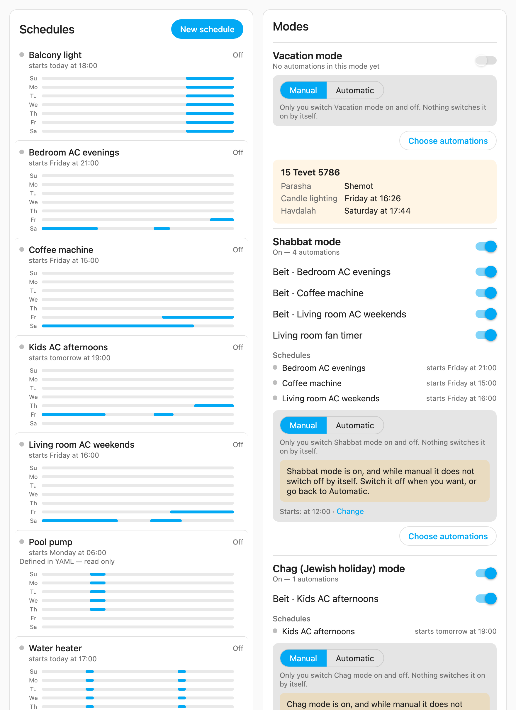
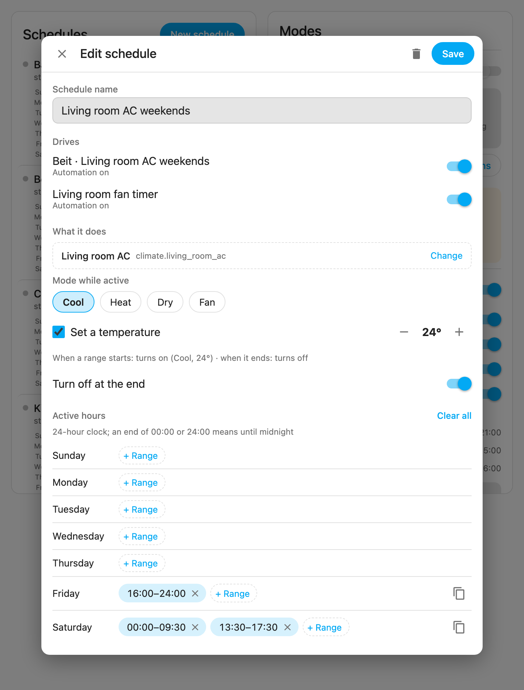
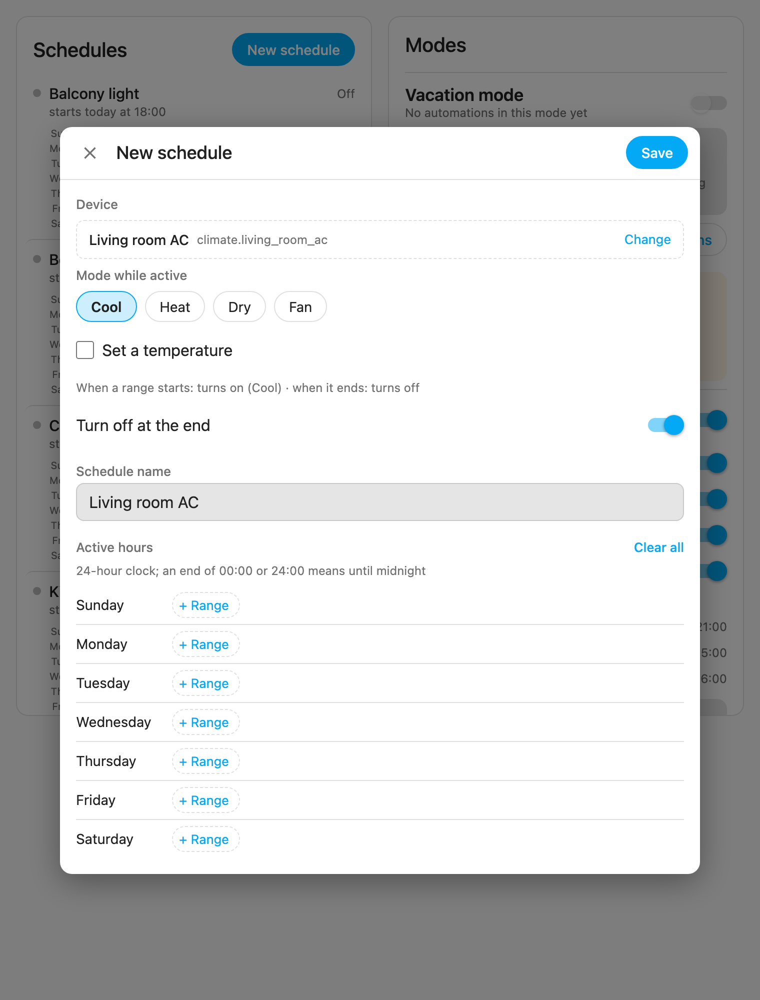
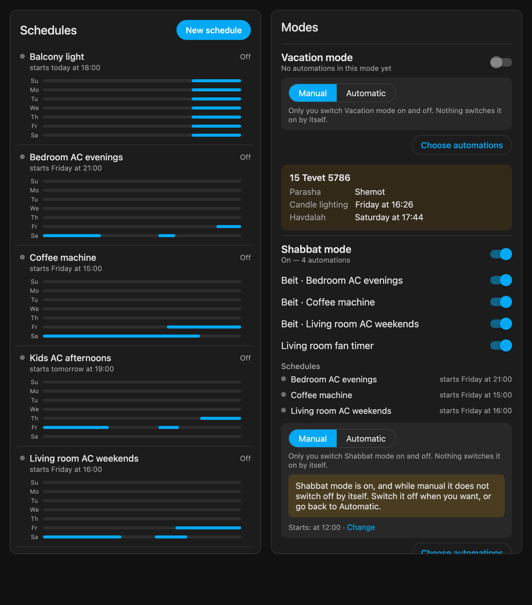
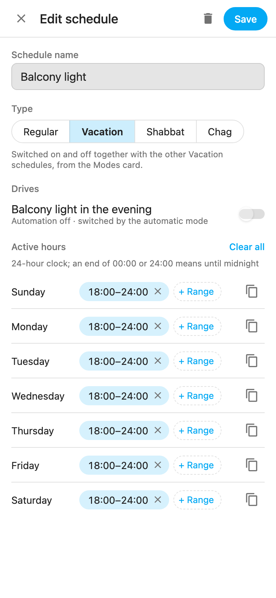

<h1 align="center">Schedule Helper Card</h1>

<p align="center">
  <b>A weekly schedule card for any device</b>, for any home, on your Home Assistant dashboard.<br>
  Built entirely on Home Assistant's own <b>schedule helper</b> and ordinary automations. No custom integration, no extra
  engine running on your server.<br>
  <b>Modes</b> switch groups of schedules together: <b>vacation</b>, by the dates you pick, and, for homes that keep
  them, Shabbat and the Jewish holidays (chag).
</p>

<p align="center">
  <a href="https://github.com/hacs/integration"></a>
  <a href="https://github.com/yybd/schedule-helper-card/releases"></a>
  <a href="https://github.com/yybd/schedule-helper-card/actions/workflows/validate.yml"></a>
  <a href="LICENSE"></a>
</p>

<p align="center"></p>

---

## Contents

- [Two cards](#two-cards)
- [Features](#features)
- [Screenshots](#screenshots)
- [Why Schedule Helper Card](#why-schedule-helper-card)
- [Requirements](#requirements)
- [Installation](#installation)
- [Configuration](#configuration)
- [Modes](#modes)
  - [Vacation](#vacation)
  - [Shabbat and Jewish holiday (chag) modes](#shabbat-and-jewish-holiday-chag-modes)
- [How it works](#how-it-works)
- [Uninstalling](#uninstalling)
- [Permissions](#permissions)
- [FAQ](#faq)
- [Contributing](#contributing)
- [License](#license)

## Two cards

> **A mode** is a group of schedules (and the automations that drive them) that runs only for a stretch of time and is
> switched on and off together. **Vacation** is the mode every home has: the schedules you want only while you are
> away, from the day you leave to the day you come back. **Shabbat** and **chag** are the same idea for homes that keep
> them, with the Jewish calendar deciding the stretch. You don't need to keep Shabbat to use any of this: Shabbat and
> chag appear only in a home that uses them (a `שבת` or `חג` label, or a Jewish calendar integration).
>
> *Chag* is Hebrew for a **Jewish holiday**: the festival days kept like Shabbat (Yom Tov), such as Rosh Hashanah,
> Yom Kippur, Sukkot, Pesach and Shavuot.

The package contains **two separate cards**. Add one or both; each works on its own.

| | Card | What it is for |
|:-:|---|---|
| 🗓️ | **Schedules**<br>`custom:schedule-helper-card`<br>*the main card* | **Setting up schedules.** Create and edit a weekly schedule for any device (air conditioner, heating, lights, water heater, plugs, blinds, speakers): the hours for each day, what the device does, and the mode it belongs to (regular, vacation, and Shabbat or chag where your home uses them). |
| ✈️ | **Modes**<br>`custom:schedule-helper-modes-card` | **Switching groups of schedules.** Vacation first: switch it on by hand, or give it the dates of your trip. Then, in homes that keep them, Shabbat and chag, with automatic Shabbat and chag and the candle lighting, havdalah and parasha. |

The Shabbat card of earlier versions, `custom:schedule-helper-shabbat-card`, still works: it is the Modes card showing
Shabbat and chag only.

## Features

### 🗓️ Schedules card

- **Schedule a device in one step.** Choose a device (air conditioner, light, water heater, plug, blinds), what it should
  do while the schedule is active (HVAC mode, temperature, brightness), and the hours for each day of the week. The card
  creates the schedule helper and the automation that drives the device.
- **Edit every schedule in the house.** A clear week view for each UI-managed schedule helper. You can add ranges, copy a
  day to the other weekdays or to the whole week, and set ranges that run until midnight. For a schedule the card
  created, you can also change the device and what it does; renaming a schedule renames its automation too.
- **Put a schedule in a mode.** Mark it as a vacation schedule (or a Shabbat or chag one, where your home uses them),
  so the Modes card switches it with the rest of the mode.

### ✈️ Modes card

- **Vacation mode.** A single switch turns on or off every automation that belongs to it, and the card shows whether
  the mode is fully on, partly on or off.
- **Automatic vacation.** Pick the dates and times you leave and come back. The mode switches on then, and off when
  you are back, once every vacation schedule has finished; afterwards it is back to manual by itself.
- **Shabbat and chag modes** (optional, for homes that keep them): the same switches, one per mode.
- **Automatic Shabbat and chag.** Switches the mode on before its schedules begin (at a time you choose, or some hours
  before candle lighting) and off after it ends, only once every schedule of the mode has finished, so no device is
  left running.
- **Jewish calendar on the card.** Candle lighting, havdalah, the parasha and today's holiday, from the core
  [Jewish Calendar](https://www.home-assistant.io/integrations/jewish_calendar/) integration (or Hebcal, if installed).

### Both

- **English and Hebrew.** The cards follow the language in each user's Home Assistant profile: Hebrew gets a full
  right-to-left layout, anything else English. The week starts on Sunday.
- **Visual editors.** Both cards are set up from the dashboard's own card editor; no YAML needed.

## Screenshots

All screenshots use the invented house in `tests/fixtures`, in English. For a user whose Home Assistant language is
Hebrew, the cards are in Hebrew and the whole layout is right to left.

| Editing a schedule | A new schedule for an air conditioner |
|:-:|:-:|
|  |  |

| Dark theme, fixed height | On a phone |
|:-:|:-:|
|  |  |

## Why Schedule Helper Card

Home Assistant already has good scheduling tools. This card makes a different trade-off. **It writes Home Assistant's
own objects rather than bringing its own scheduling engine.**

| | **Schedule Helper Card** | Built-in schedule helper editor | [Scheduler card + component](https://github.com/nielsfaber/scheduler-component) | [Weekly Schedule Card](https://community.home-assistant.io/t/weekly-schedule-card-a-visual-weekly-grid-card-for-the-scheduler-component/1012671) | [schedule_state](https://github.com/aneeshd/schedule_state) |
|---|:-:|:-:|:-:|:-:|:-:|
| Stores schedules in HA's native `schedule` helper | ✅ | ✅ | ❌ own storage | ❌ scheduler component | ❌ own sensor |
| Needs a custom integration on the server | **No** | No | Yes | Yes | Yes |
| Schedule and device configured together | ✅ | ❌ automation written by hand | ✅ | ✅ | ❌ |
| Device driven by a standard, editable HA automation | ✅ | ✅ (your own) | ❌ internal engine | ❌ internal engine | ✅ (your own) |
| Keeps working if the card is removed | ✅ | ✅ | ❌ | ❌ | ❌ |
| Vacation mode, by dates | ✅ | ❌ | ❌ | ❌ | ❌ |
| Shabbat / Jewish holiday modes | ✅ | ❌ | ❌ | ❌ | ❌ |
| Restart-safe automations | ✅ | Depends on you | ✅ | ✅ | Depends on you |
| Deletes only what it created | ✅ | — | — | — | — |
| Hebrew / right-to-left | ✅ | Partial | Partial | ❌ | ❌ |

**What this means in practice**

1. **Nothing server-side to break.** The card is a single dashboard file. There is no integration to update or to fail
   after a Home Assistant upgrade.
2. **No lock-in.** Everything the card creates is a regular schedule helper and a regular automation. You can see and
   edit them under *Settings → Automations & Scenes* and *Settings → Helpers*, and they keep working without the card.
3. **Modes, from vacation to Shabbat.** Modes are Home Assistant labels, so a mode's automations are visible and
   filterable everywhere in Home Assistant. A mode switches off only once its schedules have finished, so no device is
   cut off mid-range; automatic Shabbat is timed around real schedules, not only candle lighting.
4. **Careful by design.**
   - Automations ignore the brief "unavailable" state after a restart, so devices don't switch on or off on their own.
   - Deleting a schedule removes only the automation the card created. Automations you wrote yourself are left in
     place and listed.
5. **One data model across apps.** The card and its companion app, Beit, for iOS, Android, macOS and Windows read and
   write the same objects.

**Where other tools go further.** The Scheduler card supports arbitrary service calls, conditions and sun-based times.
The Weekly Schedule Card and the built-in editor let you draw ranges by dragging on a grid. Schedule Helper Card focuses
on device schedules and modes.

## Requirements

- Home Assistant **2025.1** or newer.
- An **administrator** account to create or edit schedules. Other users see a read-only view (see
  [Permissions](#permissions)).
- Vacation, manual or automatic, needs nothing more.
- For Shabbat and chag times and for **automatic Shabbat**: a Jewish calendar, either the
  [Jewish Calendar](https://www.home-assistant.io/integrations/jewish_calendar/) integration (recommended, see
  [Setting up Jewish Calendar](#setting-up-jewish-calendar)) or Hebcal. **Automatic chag** needs Jewish Calendar.
  Without a calendar, you can still switch the modes by hand, and the Schedules card needs none at all.

What the card adds to your Home Assistant, only when you ask it to: a **schedule helper** and an **automation** for each
schedule you create, a label per mode once you use it (`Vacation` or `חופשה`, in your language; `שבת`, `חג`), an
automation for automatic vacation, Shabbat or chag if you switch it on, and a *Schedule Helper* dashboard if you
create one. All of them are ordinary Home Assistant objects (see
[How it works](#how-it-works) and [Uninstalling](#uninstalling)).

## Installation

### HACS (recommended)

Schedule Helper Card is in the HACS default list.

[](https://my.home-assistant.io/redirect/hacs_repository/?owner=yybd&repository=schedule-helper-card&category=plugin)

Or by hand:

1. In Home Assistant, open **HACS**.
2. Search for **Schedule Helper Card**, open it and select **Download**.
3. Reload the browser.

HACS registers the dashboard resource for you.

<details>
<summary>It doesn't show up in the search</summary>

A newly listed repository can take a few hours to appear. Until then, add it as a custom repository: in HACS, open the
menu (⋮) → **Custom repositories**, add `https://github.com/yybd/schedule-helper-card` with type **Dashboard**, then
search again.
</details>

### Manual installation

1. Download `schedule-helper-card.js` from the [latest release](https://github.com/yybd/schedule-helper-card/releases/latest).
2. Copy it to `/config/www/schedule-helper-card.js`.
3. Go to *Settings → Dashboards → ⋮ → Resources → Add resource*.
4. Enter the URL `/local/schedule-helper-card.js` with type **JavaScript module**.
5. Reload the browser.

To update, replace the file and reload the browser; if the old version still shows, clear the browser cache (or add
`?v=<version>` to the resource URL).

### Add the cards

After installing, reload the browser. Then either:

- **One click: a Schedule Helper dashboard.** Open any dashboard → ⋮ → *Edit dashboard* → *Add card* → **Schedule Helper
  Card**. At the top of the card's editor, **Create the Schedule Helper dashboard** adds a new dashboard named *Schedule Helper*
  to the sidebar, with the Schedules and Modes cards. Nothing else is changed; if it already exists, the button offers to open it.
  You can close the Add card dialog without adding the card.
- **By hand.** *Settings → Dashboards → Add dashboard → New dashboard from scratch*, name it, open it, then ⋮ → *Edit
  dashboard* → ⋮ → *Raw configuration editor*, and paste:

  ```yaml
  views:
    - title: Schedule Helper
      cards:
        - type: custom:schedule-helper-card
        - type: custom:schedule-helper-modes-card
  ```

  Or add the cards to any existing dashboard from *Add card*: search for **Schedule Helper**.

### Upgrading from Beit Schedule Card (1.x)

The card was called *Beit Schedule Card* until 2.0, in the repository `yybd/beit-schedule-card` (GitHub redirects the
old address). Dashboards that use `custom:beit-schedule-card` or `custom:beit-shabbat-card` keep working. To move to 2.0:

1. In HACS, remove *Beit Schedule Card* (or *Beit Weekly Schedule*), then search HACS for *Schedule Helper Card* and download it.
   The file is now `schedule-helper-card.js`; HACS registers the new resource.
2. Check *Settings → Dashboards → ⋮ → Resources*: if `/hacsfiles/beit-schedule-card/beit-schedule-card.js` is still
   listed, delete it (HACS may leave it behind, pointing at a file that is gone).
3. Optionally, change your cards' types to `custom:schedule-helper-card` and `custom:schedule-helper-modes-card`.

## Configuration

The package contains two cards (see [Two cards](#two-cards)). Both can be added from the dashboard's **Add card** dialog
and configured in the visual editor.

### 🗓️ Schedules card

```yaml
type: custom:schedule-helper-card
title: My schedules       # optional
height: 500px              # optional: fixed height, the list scrolls
show_modes: true           # optional: offer every mode (default: vacation, plus Shabbat and chag where the home uses them)
mode: vacation             # optional: show only schedules in this mode (vacation / שבת / חג)
entities:                  # optional: show only these schedules
  - schedule.living_room_ac
```

| Option | Type | Default | Description |
|---|---|---|---|
| `title` | string | *Schedules* | Card title. The default follows the user's language (`תזמונים` in Hebrew). |
| `mode` | string | — | Show only the schedules in this mode. |
| `entities` | list | all | Show only these schedule helpers. |
| `hide_entities` | list | — | Hide these schedule helpers. |
| `show_add` | boolean | `true` | Show the **New schedule** button. |
| `height` | string | up to `700px` | A fixed height, such as `500px` or `60vh`. The title stays put and the list scrolls inside the card. Unset, the card grows with its content up to 700px; `auto` removes the limit. |
| `device_domains` | list | all | Device types offered when choosing a device, e.g. `[climate, light, water_heater]`. |
| `show_modes` | boolean | automatic | The mode chips and the mode choice in the editor. Unset: vacation, plus Shabbat and chag (Jewish holidays) in a home that has a `שבת` or `חג` label or a Jewish calendar integration. `true` offers every mode, `false` none. |

### ✈️ Modes card

```yaml
type: custom:schedule-helper-modes-card
modes: [vacation, שבת, חג] # optional
show_calendar: true        # optional
```

| Option | Type | Default | Description |
|---|---|---|---|
| `title` | string | *Modes* | Card title. The default follows the user's language (`מצבים` in Hebrew). |
| `modes` | list | automatic | Which modes to show, in this order: `vacation`, `שבת` (or `shabbat`), `חג` (or `chag`). Unset: vacation, plus Shabbat and chag in a home that uses them. |
| `height` | string | up to `700px` | A fixed height, such as `500px` or `60vh`. The title stays put and the rest scrolls inside the card. Unset, the card grows with its content up to 700px; `auto` removes the limit. |
| `show_calendar` | boolean | `true` | Show candle lighting, havdalah, the parasha and the holiday, above the Shabbat section. |

`custom:schedule-helper-shabbat-card` takes the same options; its defaults are `modes: [שבת, חג]` and the title
*Shabbat & chag (Jewish holidays)*.

## Modes

A mode is a Home Assistant **label**: `Vacation` (or `חופשה`; the card creates it in your language and recognises
either), `שבת` or `חג`. Everything below works the same for every mode; only what switches a mode automatically
differs.

- **Membership.** An automation belongs to a mode when it carries the label. The schedules it follows carry the label
  too, so they appear under the mode.
- **Changing membership.** Use **Choose automations** on the card. Membership is stored in Home Assistant, so every
  device, and the Home Assistant UI itself, sees the same list.
- **The mode switch.** It turns every member automation on or off together. The per-automation switches below it stay
  available. Switching off in the middle of a range also turns that range's device off, the way the automation would
  at the range's end; an automation the card cannot read that from is named, and its device is left as it is.
- **Manual or automatic.** Each mode is run by hand (*Manual*: only you switch it, nothing switches it on by itself)
  or *Automatic*. The card says when an automatic mode comes on next. While a mode is automatic its switches are
  locked, here and in the schedule editor, since the automatic mode would switch them back at its next start; choose
  *Manual* to switch it yourself (any user can, once the automatic mode exists).
  - Choosing *Automatic* puts the switches where the calendar says: off during the week, on during the mode.
  - A mode left on while *Manual* does not switch off by itself; the card says so.
### Vacation

The schedules you want only while you are away: lights in the evening, the water heater on the morning you come
back, the plants' valve. Put them in vacation mode (the mode choice when you edit a schedule), and they run only while
the mode is on. Every other schedule goes on as usual.

- **By hand** (*Manual*): switch vacation mode on when you leave and off when you are back.
- **Automatic vacation.** Choose *Automatic* and pick the date and time you leave and the date and time you come back.
  The card creates one automation (`Beit · Automatic vacation`) that:
  1. switches vacation mode on when you leave;
  2. switches it off when you are back, once every vacation schedule has finished (at most 6 hours later);
  3. then switches itself off, so the mode is back to *Manual*.

  The card switches the mode's automations off at once until the trip starts. If Home Assistant restarts during the
  trip, or was down when it ended, it catches up when it starts. *Change* next to the dates moves them; choosing
  *Manual* disables the automation (it is never deleted). Times are Home Assistant's local time.

### Shabbat and Jewish holiday (chag) modes

For homes that keep them. They appear in the Modes card, and as a choice in the schedule editor, once your home has a
`שבת` or `חג` label or a Jewish calendar integration.

- **Automatic Shabbat** (optional). Creates one automation that:
  1. turns the Shabbat mode on every **Friday at 12:00**, before typical Friday-afternoon schedules begin. You can pick
     another time, or a number of hours before candle lighting (with Jewish Calendar);
  2. turns it off **after Shabbat ends**, but only once every Shabbat schedule has finished. If Home Assistant was
     restarted or down at that moment, it does this when Home Assistant starts again.
- **Automatic chag** (optional, needs the core Jewish Calendar integration). The same for chag mode: on erev chag at
  the time you choose, off after the chag ends. A chag that falls on Shabbat is covered by Shabbat mode, since nothing
  in the calendar says so a day ahead.
- **Going back to manual** disables its automation. It is never deleted, so changes you made to it in Home
  Assistant survive.
- **A schedule that starts too early.** A Shabbat range that begins on Friday before the mode comes on does not run:
  its automation is still off when the range begins. The card names such schedules under *Automatic*.

### A typical week with automatic Shabbat

The automatic mode never switches a device itself. It switches the mode's **automations** on and off, and each
automation switches its device by its own schedule.

- **Sunday to Friday morning:** the Shabbat automations are off. Their schedules still go on and off by the clock, but
  nothing happens; the Schedules card marks them *Automation off · will not run*.
- **Friday at 12:00** (or the time you chose): the mode switches on. From now on each Shabbat schedule drives its
  device, e.g. the hot plate at 15:00 and the bedroom air conditioner at 21:00.
- **After havdalah:** the automatic mode waits until every Shabbat schedule has ended (at most 6 hours), so a device
  is not cut off mid-range, and then switches the mode off until next Friday.

Automatic chag works the same way, from erev chag to the end of the chag.

### Setting up Jewish Calendar

Jewish Calendar is part of Home Assistant, so there is nothing to download, but it has to be added once. The card
cannot add it for you; when it is missing, the Modes card shows a link to add it (for administrators).

[](https://my.home-assistant.io/redirect/config_flow_start/?domain=jewish_calendar)

Or by hand: *Settings → Devices & services → Add integration → Jewish Calendar*. Then:

1. **Location** and **elevation**: your home's, which Home Assistant fills in. Times are computed from them.
2. **Diaspora**: on only outside Israel. It decides which days are yom tov (one day or two).
3. **Language**: Hebrew for Hebrew names of the parasha and the holidays, or English.
4. Afterwards, under the integration's **Configure**: the minutes of candle lighting before sunset (18 by default; in
   Israel usually 20, 30 or 40, depending on your city), and of havdalah after sunset (0 uses a fixed 8.5° below the
   horizon).

The card finds the integration's sensors by their entity ids, which start with `binary_sensor.jewish_calendar_` and
`sensor.jewish_calendar_` (a `_2` suffix is fine). If you rename those entity ids, the card will not find them.

## How it works

For every schedule it creates, the card writes two standard Home Assistant objects:

1. **A schedule helper** (`schedule.*`) holding the weekly hours.
2. **An automation** (`Beit · <name>`; *Beit* is the name of the companion app that shares this data model) that performs the "on" action when the schedule turns on and the "off" action
   when it turns off.
   - It ignores transitions from `unavailable`/`unknown`, so a restart never switches a device.
   - Its description carries a marker (shared with the companion Beit app). That is how the card knows which
     automations it may later edit or delete.

The full data model is documented in [docs/contract.md](docs/contract.md).

## Uninstalling

Remove the card in HACS (or delete the file and its resource, for a manual installation). Everything it created stays
in Home Assistant and keeps working: the schedule helpers, the `Beit · …` automations, the automatic vacation, Shabbat
and chag automations, the mode labels (`Vacation` or `חופשה`, `שבת`, `חג`), and the *Schedule Helper* dashboard if you created one. To remove them as
well, delete them under *Settings → Devices & services → Helpers*, *Settings → Automations & scenes*, *Settings →
Areas, labels & zones → Labels* and *Settings → Dashboards*.

## Permissions

Home Assistant allows only administrators to create or change helpers, automations and labels. For non-admin users,
the card shows schedules (with their week) and modes read-only. Switching a mode on or off uses ordinary service calls and works for
every user.

## FAQ

**Can I edit a schedule the card created in Home Assistant's own editor?**
Yes. Both the helper and the automation are standard objects. If you rewrite the automation by hand, the card no
longer rewrites it when you change the schedule. Deleting the schedule from the card still deletes the automation while
its description carries the card's marker (`נוצר באפליקציית Beit`); remove that text from the description to keep it.

**What happens to my existing schedules and automations?**
The card lists your existing UI-managed schedule helpers and lets you edit their hours. It never modifies or deletes
automations it did not create. Schedules defined in YAML are shown read-only, since Home Assistant does not allow them
to be edited through its API.

**Does it work in the Home Assistant Companion app?**
Yes. It is a regular dashboard card, so it works wherever your dashboards do.

## Contributing

Issues and pull requests are welcome.

- Run the tests with `node --test 'tests/*.test.mjs'`, and the browser tests (headless Chrome) with
  `node dev/ui-test.mjs`.
- Preview the card without Home Assistant with `python3 dev/serve.py`, then open http://localhost:8766. The preview
  runs on a fake Home Assistant over the synthetic data in `tests/fixtures`. To look at your own Home Assistant, put
  `{"url": "...", "token": "..."}` in `dev.env.json` (git-ignored) and add `?live=1`. Live mode is read-only unless you
  also add `&writes=1`.

## License

[MIT](LICENSE)
